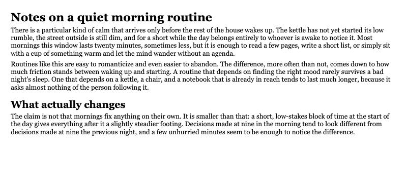
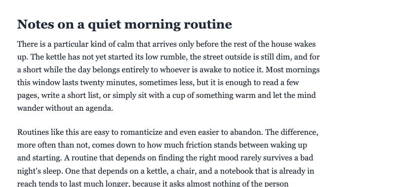

# Example: article body text

A short article, styled two ways: [`before.html`](before.html) without the skill, [`after.html`](after.html) with it applied. Same markup and copy — only the CSS changes.

## Before



## After



## What changed, and why

| Issue in `before.html` | Fix in `after.html` | Principle / reference |
|---|---|---|
| No `max-width` — text runs the full viewport width, well past 75 characters per line | `max-width: 38em` (~66 characters at this font/size) | Typography — [`references/typography.md`](../../references/typography.md) |
| `line-height: 1.15` — too tight for body copy at any measure | `line-height: 1.6`, appropriate for the corrected measure | Typography — [`references/typography.md`](../../references/typography.md) |
| Heading sizes (26px, 22px) and base size (15px) picked independently, no consistent ratio | All sizes derived from one base (`1.125rem`) and one ratio (`1.25`) via custom properties | Typography — [`references/typography.md`](../../references/typography.md) |
| Paragraph and heading margins (`4px`, `6px`, `18px`) are arbitrary, unrelated values | All spacing derives from one `--rhythm: 1.6rem` unit | Space & rhythm — [`references/space-and-rhythm.md`](../../references/space-and-rhythm.md) |

## Reproducing this

```bash
cd examples/article-typography
python3 -m http.server 8000
# then open http://localhost:8000/before.html and /after.html
```
