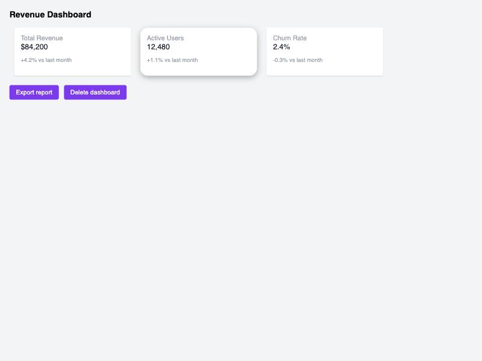
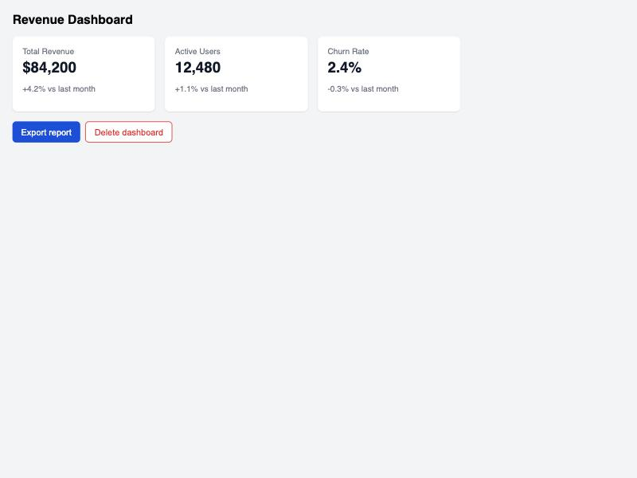

# Example: dashboard stat cards

A small "revenue dashboard" component, styled two ways: [`before.html`](before.html) without the skill, [`after.html`](after.html) with it applied. Same markup, same content — only the CSS changes.

## Before



## After



## What changed, and why

| Issue in `before.html` | Fix in `after.html` | Principle / reference |
|---|---|---|
| Cards are `flex-wrap` boxes at a fixed `220px` width — no shared column system | `display: grid` with `repeat(3, 1fr)` so card width is always a fraction of the row | Grid & layout — [`references/grid-layout.md`](../../references/grid-layout.md) |
| Spacing is ad hoc: `10px`, `14px`, `2px`, `6px` margins/padding with no shared unit | Every margin/padding/gap derives from one `--space: 1rem` custom property | Space & rhythm — [`references/space-and-rhythm.md`](../../references/space-and-rhythm.md) |
| The number that matters most (`$84,200`) is only 16px/weight 400 — barely bigger than its label | Bumped to `1.5rem`/weight 700, clearly the loudest thing in the card | Contrast & hierarchy — [`references/contrast-and-hierarchy.md`](../../references/contrast-and-hierarchy.md) |
| The second card has a different border-radius and a much heavier shadow for no reason | All three cards share identical radius/shadow — the repeating pattern now reads as one system | Balance & unity — [`references/balance-and-unity.md`](../../references/balance-and-unity.md) |
| Label text `#9ca3af` is ~2.6:1 contrast on white — fails WCAG AA for body text | Swapped to a gray step that clears 4.5:1 at that size | Color — [`references/color.md`](../../references/color.md) |
| Primary action ("Export") and destructive action ("Delete") use the *same* purple — no color distinction between "do this" and "irreversible" | Primary uses a blue action color; delete is outlined in a red/danger color — color now signals two different kinds of action | Color — [`references/color.md`](../../references/color.md) |

## Reproducing this

Both files are self-contained (inline `<style>`, no build step) — open either directly in a browser, or serve the folder locally:

```bash
cd examples/dashboard-card
python3 -m http.server 8000
# then open http://localhost:8000/before.html and /after.html
```
