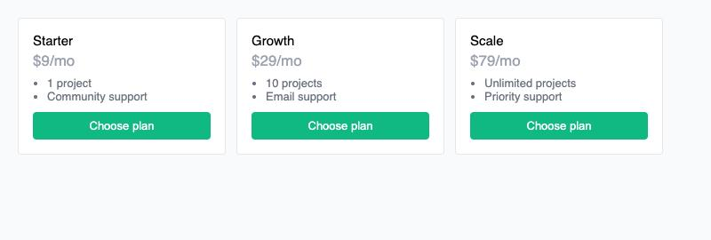

# Example: pricing cards

Three pricing tiers, styled two ways: [`before.html`](before.html) without the skill, [`after.html`](after.html) with it applied. Same markup, same plans and copy — only the CSS changes.

## Before



## After


## What changed, and why

| Issue in `before.html` | Fix in `after.html` | Principle / reference |
|---|---|---|
| All three plans look identical — no visual signal for which one most people should pick | The middle plan is visually promoted: border, shadow, a slight lift, and a "Most popular" tag | Contrast & hierarchy — [`references/contrast-and-hierarchy.md`](../../references/contrast-and-hierarchy.md) |
| The price — the single most important number on the card — is `font-weight: 400` and light gray (`#9ca3af`), the same visual weight as the fine print | Price is bold, large, and dark; the `/mo` suffix is demoted to a smaller, lighter span | Contrast & hierarchy — [`references/contrast-and-hierarchy.md`](../../references/contrast-and-hierarchy.md) |
| Every "Choose plan" button is the same saturated green regardless of plan — no distinction between the recommended choice and the others | Non-featured buttons are outlined/secondary; only the featured plan's button is filled with the brand color | Color — [`references/color.md`](../../references/color.md) |
| Spacing is arbitrary (`4px`, `8px`, `10px`, `16px`) with no shared unit | All spacing derives from one `--space: 1rem` unit | Space & rhythm — [`references/space-and-rhythm.md`](../../references/space-and-rhythm.md) |
| Three equal-weight cards in a row with nothing to anchor the eye — balance by symmetry only | The featured card breaks symmetry on purpose (lifted, bordered) while the outer two stay equal — asymmetrical balance with one clear focal point | Balance & unity — [`references/balance-and-unity.md`](../../references/balance-and-unity.md) |

## Reproducing this

```bash
cd examples/pricing-cards
python3 -m http.server 8000
# then open http://localhost:8000/before.html and /after.html
```
